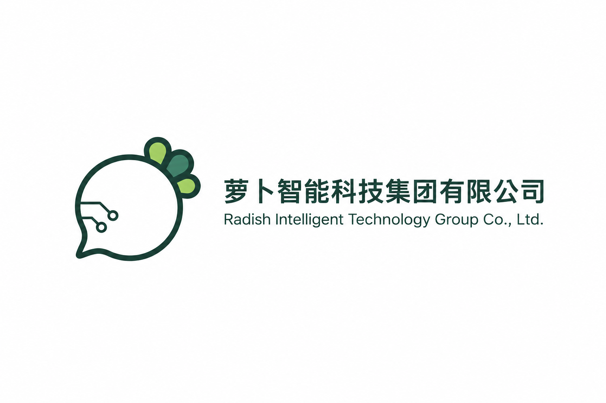

# Radish Intelligence · 组织说明仓库

本仓库对应 GitHub 上的 [`RadishIntelligence/.github`](https://github.com/RadishIntelligence/.github)，用于维护萝卜智能（Radish Intelligence）的组织主页介绍，并作为后续公共协作配置的存放入口。

萝卜智能是由个人发起和维护的 Radish 项目系列。组织介绍、产品矩阵与联系方式见 [`profile/README.md`](profile/README.md)；系列官网为 [RadishX](https://radishx.com/)。

## 暂定公司名称与 Logo

> **暂定方案说明：目前尚未成立公司，Radish 项目系列仍由个人发起和维护。以下公司名称仅为拟用名称；中英文名称、品牌名、简写及 Logo 均为暂定方案，后续可能随时更改，不代表已注册或已成立的公司。**

<p align="left">
  
</p>

| 项目 | 暂定内容 |
| --- | --- |
| 拟用中文公司全名 | 萝卜智能科技集团有限公司 |
| 拟用英文公司全名 | Radish Intelligent Technology Group Co., Ltd. |
| 中文品牌名 | 萝卜智能 |
| 英文品牌名 | Radish Intelligence |
| 品牌简写 | RI |
| Logo | 第九稿（V9），2026-09-27 选定的暂定基准 |

原始组合图沿用 RadishX 的 `assets/brand/radish-intelligence/selected-v9/company-lockup.png`，以原始 PNG 副本 `profile/assets/company-lockup-v9.png` 保存在本仓库，未裁切、压缩或重新生成。2026-10-01 按所有者要求用于本仓库与组织主页说明。

2026-11-02 按所有者要求，使用内置 imagegen 基于 V9 组合图制作 3:2 展示版（1536 × 1024）：Logo 居中置于上方，中英文全名在下方居中排列，放大文字并缩减上下空白，保留四周安全边距。两份 README 共用该展示版；原始组合图保留，V9 暂定基准不变。以上展示不授予第三方素材复用权利。

2026-11-03 使用内置 imagegen 另制作独立的 3:2 左右版（1536 × 1024）：Logo 在左，公司名在右，中文分两行、英文分三行，使文字块与 Logo 高度接近。所有者已确认保留亮色上下版和左右版，组织主页使用亮色上下版。

同日基于两款已确认构图，使用内置 imagegen 各制作一张独立的深色模式样张，均为 1536 × 1024（3:2）。深色样张采用墨绿色背景、浅色文字与 Logo 轮廓，保留绿色叶片，沿用对应亮色版的排布与留白。

同日补充两张单色上下版样张（1536 × 1024，3:2）：白底黑线黑字、黑底白线白字，三片叶子均去掉内部填色，保留轮廓。两份 README 继续使用亮色彩色上下版，通过 HTML `width="300"` 限制展示宽度并居左排列，减少页面占用；图片文件本身的尺寸保持不变。

## 文件用途

| 文件 | 用途 |
| --- | --- |
| `README.md` | 说明本仓库的结构与维护方式，展示在仓库首页。 |
| `profile/README.md` | 面向访客的组织介绍，展示在 GitHub 组织的 Overview 页面。 |
| `profile/assets/company-lockup-v9.png` | 保留的 V9 Logo 与拟用中英文公司名称原始组合图（2400 × 1200）。 |
| `profile/assets/company-lockup-v9-profile-3x2.png` | 两份 README 共用的 3:2 亮色上下展示版（1536 × 1024），所有者已确认使用。 |
| `profile/assets/company-lockup-v9-profile-horizontal-3x2.png` | 独立的 3:2 亮色左右展示版（1536 × 1024），所有者已确认保留。 |
| `profile/assets/company-lockup-v9-profile-dark-3x2.png` | 3:2 深色上下版样张（1536 × 1024）。 |
| `profile/assets/company-lockup-v9-profile-horizontal-dark-3x2.png` | 3:2 深色左右版样张（1536 × 1024）。 |
| `profile/assets/company-lockup-v9-profile-mono-light-3x2.png` | 3:2 白底黑线黑字上下版样张，叶片空心（1536 × 1024）。 |
| `profile/assets/company-lockup-v9-profile-mono-dark-3x2.png` | 3:2 黑底白线白字上下版样张，叶片空心（1536 × 1024）。 |

当前仓库维护以上两份说明文档及配套品牌展示图片，尚未提供组织级 Issue 模板、Pull Request 模板或其他公共协作配置。

## 本地目录与 GitHub 展示

本地克隆目录可以命名为 `RadishIntelligence-Profile`，方便在 Finder 中查看；GitHub 远程仓库仍保留 `.github` 名称，组织主页文件仍位于 `profile/README.md`。

```text
RadishIntelligence-Profile/
├── README.md
└── profile/
    ├── README.md
    └── assets/
        ├── company-lockup-v9.png
        ├── company-lockup-v9-profile-3x2.png
        ├── company-lockup-v9-profile-horizontal-3x2.png
        ├── company-lockup-v9-profile-dark-3x2.png
        ├── company-lockup-v9-profile-horizontal-dark-3x2.png
        ├── company-lockup-v9-profile-mono-light-3x2.png
        └── company-lockup-v9-profile-mono-dark-3x2.png
```

组织主页使用公开 `.github` 仓库中的 `profile/README.md`。更新后需提交并推送到远程默认分支，才会更新线上展示。展示规则见 [GitHub 官方文档](https://docs.github.com/en/organizations/collaborating-with-groups-in-organizations/customizing-your-organizations-profile)。

## 内容维护

- 两份 README 同步维护暂定名称、Logo 版本及“公司尚未成立、方案可能随时更改”的说明。
- 成员墙在 `profile/README.md` 的“我们的成员”章节手动维护；每位成员对应一行头像与 GitHub 主页链接，按源码顺序展示。新增或调整成员时，同步修改该行的用户名、链接、头像地址及提示文字，提交并推送后生效。
- 组织介绍保持“由个人发起和维护”的实际定位；产品定位与入口参考 [RadishX 仓库](https://github.com/laugh0608/RadishX)，具体能力、发布状态与使用方式以各项目文档为准。
- 项目矩阵按十三个产品组织；`RadishX` 是官网，`RadishAxiomChecker` 是 `RadishAxiom` 的配套检查器，`RadishUI` 作为共享设计系统单独介绍。
- 仓库链接按已确认的实际地址维护；项目转移后再核验并更新，不提前替换为尚不存在的组织地址。
- 仅列出有依据的公开入口，不将规划域名、开发目标或内部验证成果写成已上线服务。
- 各项目的许可与素材使用范围以对应仓库说明为准，本仓库不统一授予授权。

## 相关入口

- [GitHub 组织](https://github.com/RadishIntelligence)
- [组织主页文案](profile/README.md)
- [RadishX 官网](https://radishx.com/)
- [RadishUI 设计系统预览](https://ui.radishx.com/) · [源码](https://github.com/RadishIntelligence/RadishUI)
- [维护者 GitHub](https://github.com/laugh0608)
